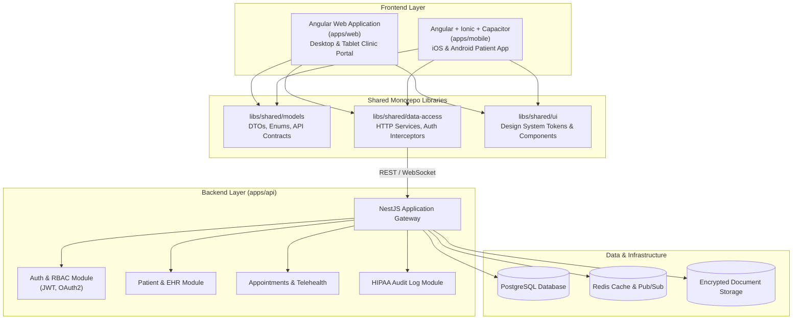
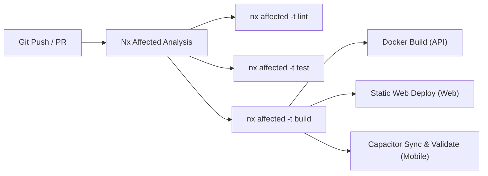
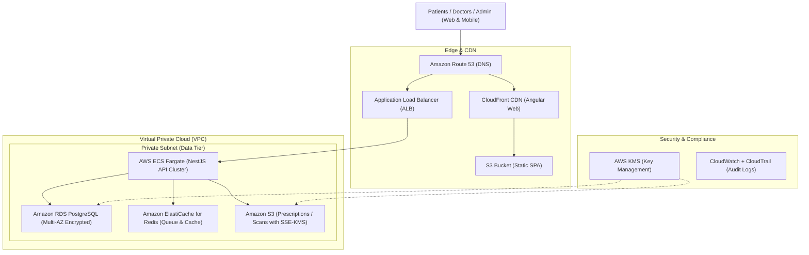

# System Architecture & Technical Design

## 1. Executive Summary

`medical-proj` is an enterprise-grade full-stack medical platform. The system is designed around an **Nx Integrated Monorepo** delivering a unified TypeScript ecosystem across a **NestJS** backend, an **Angular** web portal, and an **Ionic + Capacitor** cross-platform mobile application (iOS & Android).

---

## 2. High-Level Architecture Diagram



---

## 3. Monorepo Project Topology

```
medical-proj/
├── apps/
│   ├── api/                     # NestJS Backend API
│   │   ├── src/
│   │   │   ├── app/
│   │   │   │   ├── auth/        # Authentication & Role-Based Access Control
│   │   │   │   ├── patients/    # Patient Records & EHR
│   │   │   │   ├── appointments/# Scheduling & Consultations
│   │   │   │   └── common/      # Guards, Interceptors, Filters
│   │   │   └── main.ts
│   │   └── Dockerfile
│   │
│   ├── web/                     # Angular Web Portal (Staff & Doctors)
│   │   ├── src/
│   │   │   ├── app/
│   │   │   │   ├── core/        # Singleton services, interceptors, guards
│   │   │   │   ├── features/    # Lazy-loaded routed views
│   │   │   │   └── shared/      # Feature-local shared components
│   │   │   └── main.ts
│   │   └── project.json
│   │
│   └── mobile/                  # Angular + Ionic + Capacitor (Patients)
│       ├── src/
│       │   ├── app/
│       │   │   ├── tabs/        # Ionic Tab Navigation
│       │   │   └── pages/       # Mobile pages with Ionic components
│       │   └── main.ts
│       ├── android/             # Android Studio native project
│       ├── ios/                 # Xcode native project
│       ├── capacitor.config.ts  # Capacitor native bridge settings
│       └── project.json
│
├── libs/
│   └── shared/
│       ├── models/              # Pure TypeScript DTOs, interfaces, enums
│       ├── data-access/         # Shared HTTP clients, Auth state, API services
│       └── ui/                  # Reusable UI components & design tokens
│
├── .github/
│   └── workflows/
│       └── ci.yml               # Nx Affected CI/CD pipeline
│
├── docker-compose.yml           # Local development infrastructure (Postgres, Redis)
├── nx.json                      # Nx workspace configuration
├── tsconfig.base.json           # Path mappings (@medical-proj/*)
├── GEMINI.md                    # Agent instructions & rules
├── PROJECT_STATE.md             # Living state and roadmap tracker
└── ARCHITECTURE.md              # System architecture reference (this file)
```

---

## 4. Module Boundaries & Dependency Enforcement

To prevent architectural decay, Nx tags and ESLint boundaries enforce strict dependency rules:

| Scope                | May Import From                                                   | May NOT Import From                         |
| :------------------- | :---------------------------------------------------------------- | :------------------------------------------ |
| `apps/api`           | `libs/shared/models`                                              | `apps/web`, `apps/mobile`, `libs/shared/ui` |
| `apps/web`           | `libs/shared/models`, `libs/shared/data-access`, `libs/shared/ui` | `apps/api`, `apps/mobile`                   |
| `apps/mobile`        | `libs/shared/models`, `libs/shared/data-access`, `libs/shared/ui` | `apps/api`, `apps/web`                      |
| `libs/shared/models` | _None (Zero external dependencies)_                               | Any `apps/*` or other `libs/*`              |

---

## 5. Mobile Architecture (Ionic + Capacitor)

### Why Ionic + Capacitor for Healthcare?

1. **Direct Angular Code Reuse**: 90%+ of services, validation logic, and DTOs are shared verbatim between `apps/web` and `apps/mobile`.
2. **Native Device Hardware Access**:
   - `@capacitor/camera`: Instant photo capture for prescriptions and insurance cards.
   - `@capacitor/biometrics`: Fingerprint / Face ID for secure patient authentication.
   - `@capacitor/push-notifications`: Appointment reminders and prescription alerts.
   - `@capacitor/preferences` / `@capacitor-community/sqlite`: Secure encrypted local cache.
3. **Hardware-Accelerated UI**:
   - Ionic components adapt automatically to **iOS (Cupertino)** and **Android (Material Design)** themes without writing platform-specific styling.

---

## 6. Security & Healthcare Compliance Foundations

- **HIPAA-Ready Logging**: All patient-data access is routed through an audit interceptor in `apps/api` logging timestamp, user ID, and resource ID (never logging unencrypted PHI).
- **Authentication**: Stateless JWT with short-lived access tokens (15m) and secure HttpOnly refresh cookies (or Capacitor Secure Storage on mobile).
- **Transport Security**: Enforce TLS 1.3 in transit and AES-256 for all stored medical documents.
- **DTO Validation**: Strict `whitelist: true` and `forbidNonWhitelisted: true` on all NestJS inputs to prevent parameter injection attacks.

---

## 7. CI/CD & Build Pipeline Strategy



- **Nx Affected**: Only modified apps and libraries are tested and built, reducing PR check times from minutes to seconds.
- **Docker**: NestJS is built as a multi-stage Alpine Linux container for minimal attack surface and fast startup.

---

## 8. Developer Runbook & CLI Commands

| Command                  | Action                                     | Scope / URL                   |
| :----------------------- | :----------------------------------------- | :---------------------------- |
| `npm run dev:api`        | Starts NestJS API server                   | `http://localhost:3000`       |
| `npm run dev:web`        | Starts Angular Web Portal                  | `http://localhost:4200`       |
| `npm run dev:mobile`     | Starts Mobile App (Browser preview)        | Local Dev Server              |
| `npm run build:all`      | Compiles API, Web, and Mobile              | Output to `dist/apps/*`       |
| `npm run test:all`       | Runs all Jest unit tests non-interactively | All test suites               |
| `npm run lint:all`       | Runs ESLint across all apps and libs       | Strict TypeScript validation  |
| `npm run mobile:sync`    | Builds mobile and syncs native assets      | `apps/mobile/android` & `ios` |
| `npm run mobile:ios`     | Launches mobile app in Xcode               | macOS native development      |
| `npm run mobile:android` | Launches mobile app in Android Studio      | Android native development    |

---

## 9. Cloud Architecture & Target Topology (AWS)

Per **ADR-006**, Amazon Web Services (AWS) is the designated cloud infrastructure provider.



### AWS Service Architecture Breakdown

1. **Frontend Hosting (`apps/web`)**: Amazon CloudFront CDN + Amazon S3 static website bucket with global edge caching and automatic SPA fallback.
2. **Backend API Gateway (`apps/api`)**: AWS ECS Fargate serverless container tasks running inside private subnets behind an Application Load Balancer (ALB) with auto-scaling.
3. **Relational Database**: Amazon RDS for PostgreSQL 16 (Multi-AZ failover, automated point-in-time recovery, and AWS KMS encryption at rest).
4. **Caching & Live Token Queues**: Amazon ElastiCache for Redis (rate limiting, session tokens, and live waiting-room queue state).
5. **Medical Documents & PHI Storage**: Amazon S3 with Server-Side Encryption (SSE-KMS), strict Block Public Access, and time-limited presigned URLs (15m expiry) for patient reports and prescriptions.
6. **Healthcare Compliance**: AWS Business Associate Addendum (BAA) coverage, TLS 1.3 in-flight encryption, and immutable access logging via AWS CloudTrail and Amazon CloudWatch.
